# PayGuard

Sandbox payment and transaction reliability platform. PayGuard records simulated charges, keeps one payment when a request is retried, and shows webhook and reconciliation failures to an operator.

## Project introduction

A payment request, a provider call, and a webhook can all be duplicated or interrupted. The ledger still has to show one payment, a legal state change, and an audit trail. PayGuard is a small operations console for that problem.

Payment reliability matters because a timeout is not the same thing as a decline. If the system marks an unknown charge as failed, a later capture can double-charge the customer. If it ignores a duplicate request, the merchant gets two payments for one order. PayGuard keeps those cases visible instead of hiding them behind a single "success" flag.

What is real:

- PostgreSQL is the source of truth for users, payments, ledger rows, idempotency keys, webhook events, reconciliation, and audit logs.
- Redis caches dashboard summaries, counts rate limits, stores a short-lived access-token denylist, and hosts the BullMQ queue.
- The API and the worker are separate processes. Webhook delivery is asynchronous, signed, and retried.
- Passwords are bcrypt hashes. Sessions use HttpOnly cookies.

What is simulated:

- The gateway is an in-process function. It does not call a card network.
- Provider statements are rows in `provider_statements`, not a bank file.
- Webhook endpoints are local or explicitly allowed URLs. No money moves.
- The project does not accept card numbers, CVVs, or bank credentials, and it does not claim PCI DSS compliance.

## Screenshots and visual overview

These are screenshots of the local console signed in as the seeded administrator, except the login page.

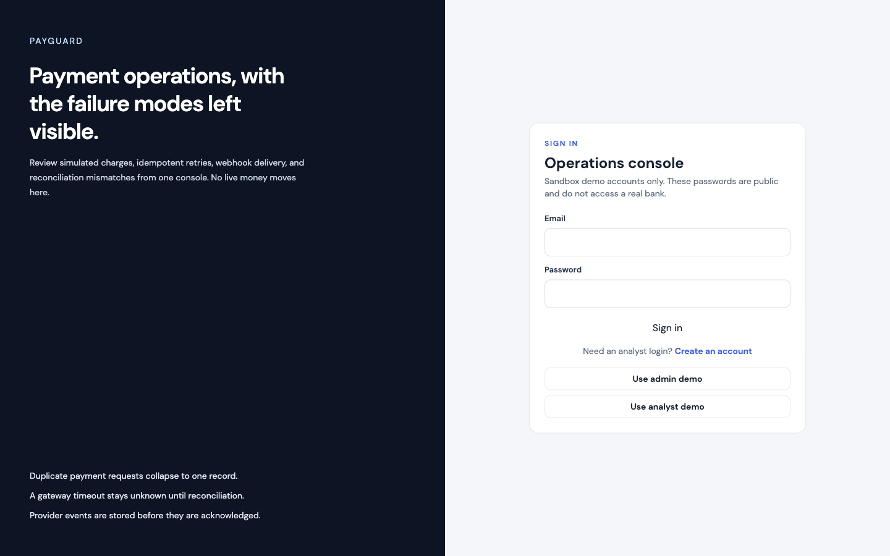

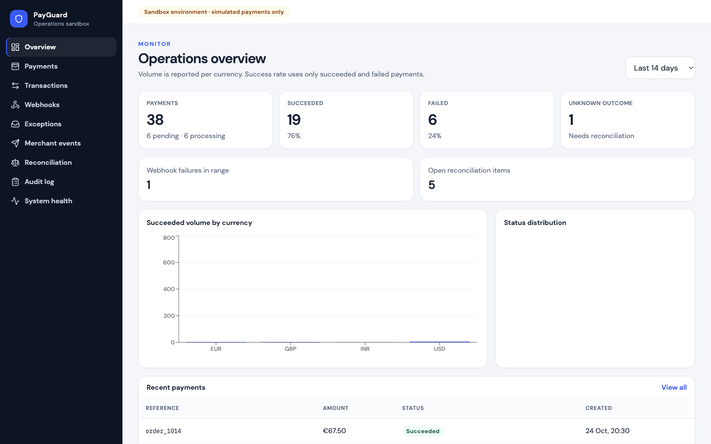

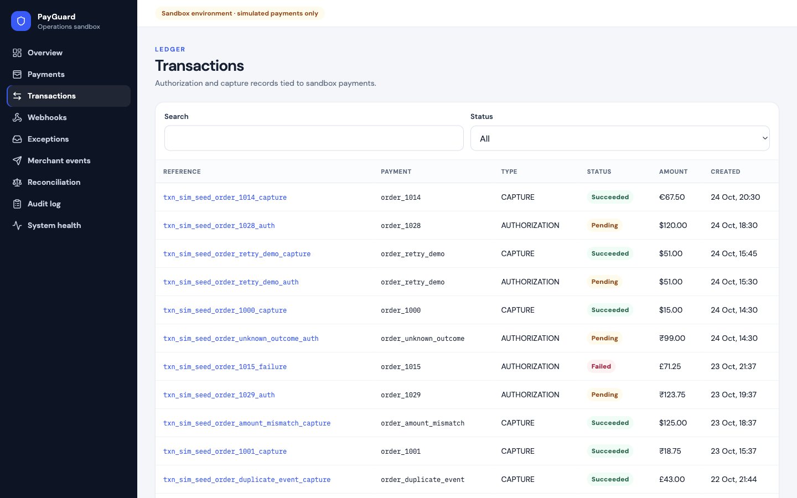

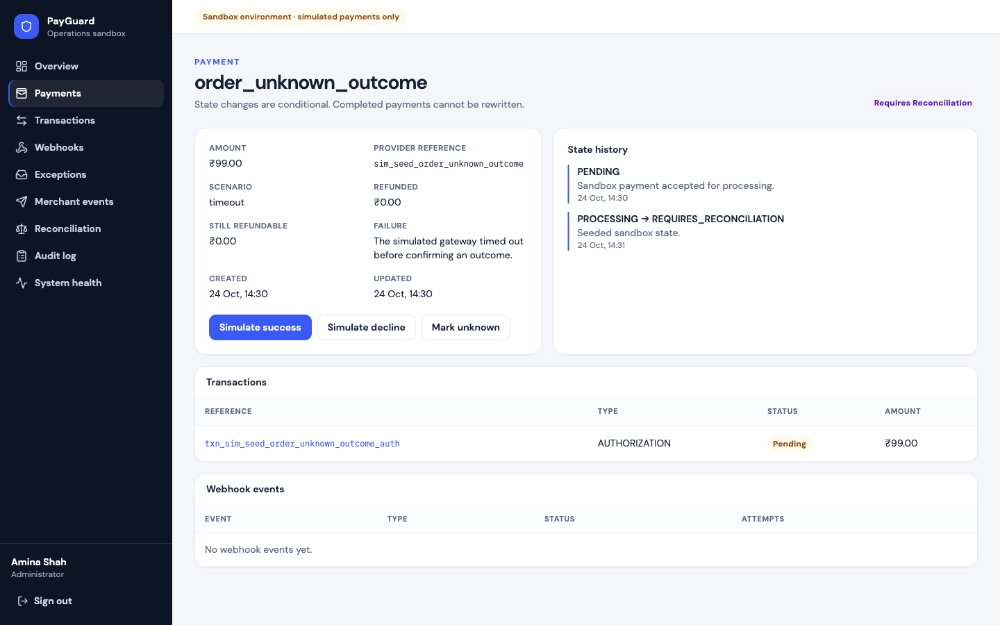

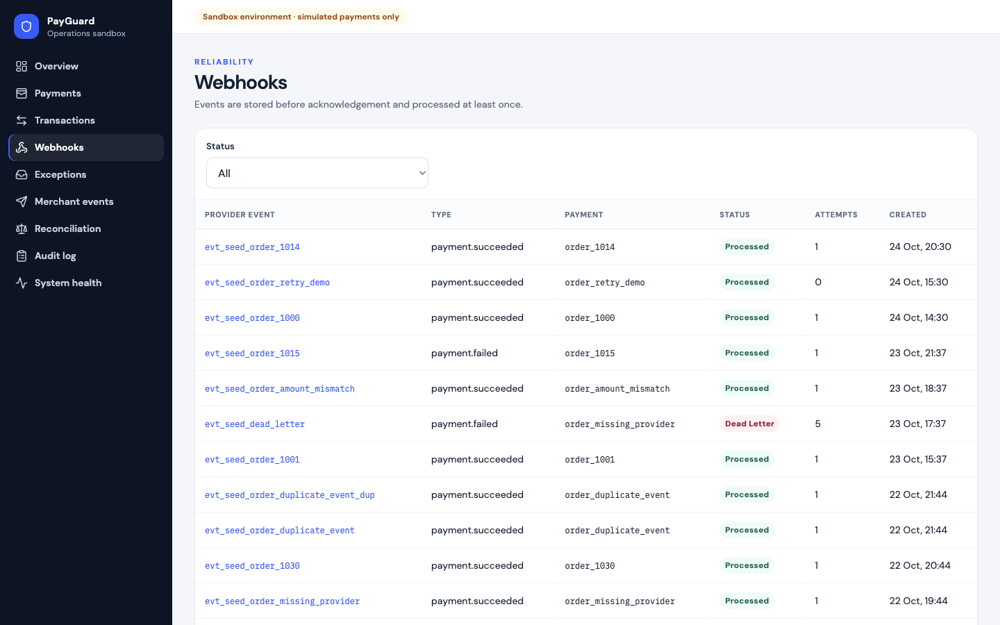

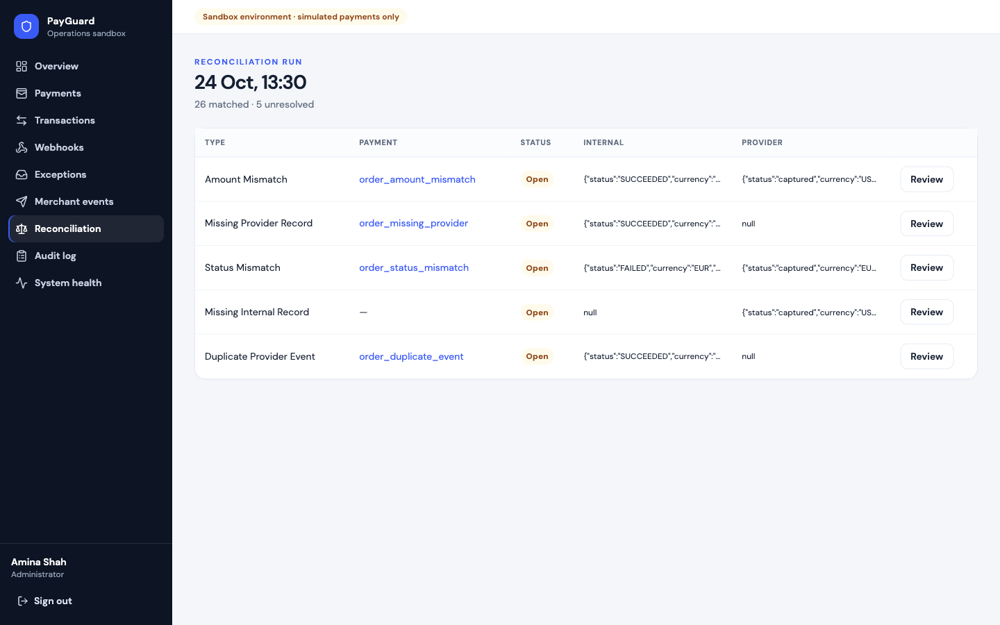

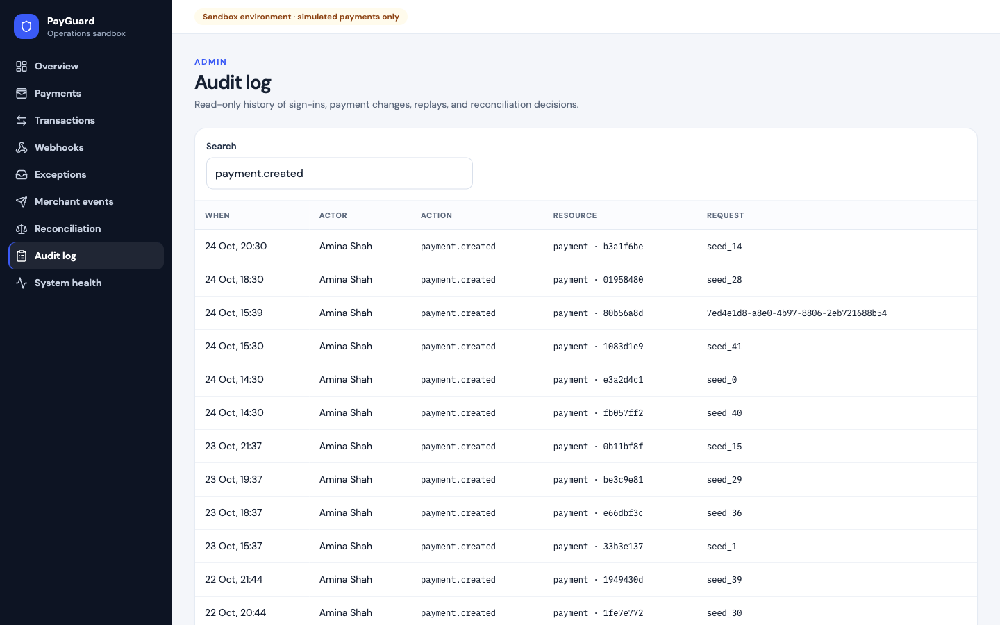

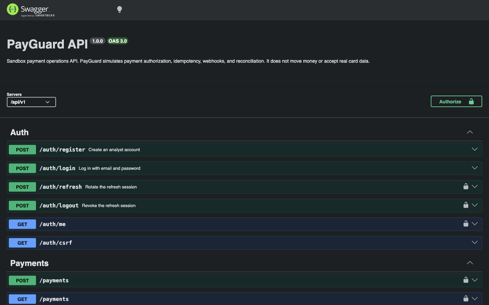

## Feature overview

Implemented:

- **Registration and login.** `POST /api/v1/auth/register` creates an analyst. It does not accept a role. Login, refresh, and logout use HttpOnly cookies. Refresh tokens rotate. Reuse of a revoked refresh token revokes that user's outstanding refresh sessions. Logout revokes the refresh row and best-effort denylists the access token.
- **Roles.** `ADMIN` can operate the sandbox. `ANALYST` can read payments, transactions, webhooks, exceptions, merchant events, reconciliation, the dashboard, and health. Analysts cannot create payments, simulate outcomes, refund, void, replay deliveries, run reconciliation, resolve mismatches, or read the audit log.
- **Payments.** Create a simulated charge with an amount in minor units, a currency (`USD`, `INR`, `EUR`, `GBP`), and a scenario. Scenarios are `success`, `decline`, `gateway_failure`, `timeout`, and `delayed_webhook`. The API returns the payment, and a later read shows the same status.
- **State machine.** Allowed moves are enforced in code and covered by tests. `FAILED`, `VOIDED`, and `REFUNDED` are terminal. A succeeded payment can be partially refunded or refunded. A refund cannot exceed the captured amount. A void is only available before capture.
- **Ledger.** Each meaningful payment step writes a transaction with its own reference: authorization, capture, void, refund, or adjustment.
- **Lists.** Payments and transactions support pagination, search, status filters, and sort. Payments also filter by currency and created-at range.
- **Idempotency.** Payment creation, refunds, and voids require an `Idempotency-Key`. The key is scoped to the user and operation. The same key and payload replay the original response. A different payload returns `409 IDEMPOTENCY_PAYLOAD_MISMATCH`. Concurrent duplicates collapse to one payment because of a unique database constraint.
- **Provider webhooks.** Events are stored before they are acknowledged. The provider event id is unique. The body is signed with HMAC-SHA256. An outbox row is committed with the event. The worker publishes it to BullMQ. Delivery attempts are recorded. Failed and dead-letter events can be replayed by an administrator. A processed event cannot be replayed.
- **Merchant webhooks.** Administrators register an outbound URL. The signing secret is returned once and omitted from later reads. Delivery is asynchronous, signed, timeout-bounded, and retried. HTTP is allowed only for localhost. Private and link-local addresses are rejected, and redirects are not followed. A local sink records receipts for development.
- **Reconciliation.** A run compares internal payments with the sandbox provider statement. It stores matches and mismatches: amount, missing provider record, missing internal record, status, and duplicate provider event. Resolve and ignore do not change the payment.
- **Exceptions.** Unknown outcomes (`REQUIRES_RECONCILIATION`) are listed for an operator decision.
- **Audit log.** Sign-in, registration, payment changes, webhook replays, and reconciliation decisions store an actor, action, resource, time, and request id. Passwords, tokens, and webhook secrets are not stored.
- **Dashboard.** Volume is reported per currency. Success rate uses succeeded and failed payments only. Unknown outcomes are counted separately. The summary is cached for 30 seconds. Payment status is always read from PostgreSQL.
- **Health.** `/health/live` and `/health/ready` are public. The signed-in health page adds worker heartbeat and queue depth.
- **API docs.** Swagger UI is served from the same OpenAPI document the API implements.

Limitations, also listed under [Testing and known limitations](#testing-and-known-limitations):

- Two-decimal currencies only.
- The access-token denylist depends on Redis. Refresh revocation in PostgreSQL is the logout boundary.
- Dashboard figures can be up to 30 seconds stale.
- Rate limits fail closed while Redis is unavailable.
- Merchant URL checks are a development SSRF control. They are not a complete defense against DNS rebinding.
- There is no card network, no settlement file from a bank, and no claim of compliance certification.

## Architecture

PayGuard is a modular monolith. The API and the worker share one PostgreSQL database and one Redis instance. They are not independently deployed microservices.

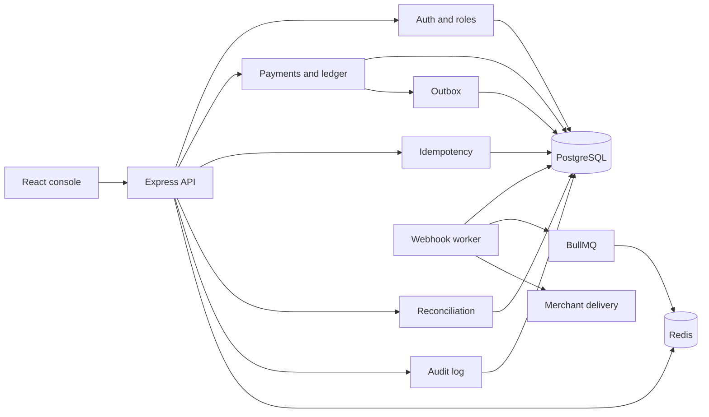

Request path: route, authentication, permission check, Zod validation, controller, service, repository. Controllers map HTTP. Services own transactions, the state machine, idempotency, and audit writes.

PostgreSQL holds the invariants. Redis holds cache, rate limits, the access-token denylist, and the queue. Losing Redis must not invent a payment status.

More detail is in [docs/architecture.md](docs/architecture.md), [docs/database-design.md](docs/database-design.md), [docs/reliability.md](docs/reliability.md), and [docs/PROJECT_AUDIT.md](docs/PROJECT_AUDIT.md).

## Technology stack

| Technology | Why it is here |
| --- | --- |
| Node.js and Express | One HTTP process for the API, with middleware for request ids, timeouts, CORS, cookies, and errors. |
| TypeScript | Shared request and response shapes across the API and the console. |
| PostgreSQL and Prisma | Constraints and transactions for payments, idempotency, and webhook deduplication. Migrations are committed. |
| Redis and BullMQ | Rate limits, a short dashboard cache, and at-least-once webhook jobs. |
| Zod | One validation library for request bodies, query strings, and environment variables. |
| React, Vite, React Router | The operations console. |
| TanStack Query and Axios | Server state, retries of a single 401 refresh, and typed API calls. |
| Tailwind, Recharts, Sonner | Layout, dashboard charts, and toast feedback. The project does not add a component framework on top of these. |
| Vitest and Supertest | Unit tests without a database, and integration tests against `payguard_test`. |
| Docker Compose | PostgreSQL 16 and Redis 7 for a clean machine. The API, worker, and frontend can also run on the host. |

## Folder structure

```text
backend/src/modules        identity, payments, transactions, idempotency,
                           webhooks, merchant-webhooks, exceptions,
                           reconciliation, audit, dashboard, health, jobs
backend/src/common         errors, validation, auth middleware, responses
backend/src/infrastructure prisma, redis, queue, cache, logger
backend/src/openapi        OpenAPI document served by Swagger UI
backend/prisma             schema, migrations, seed
backend/tests              unit and integration tests
frontend/src/pages         console screens
frontend/src/auth          session bootstrap and route guards
frontend/src/api           Axios client and response types
docs                       architecture, schema, API, reliability, audit
docs/screenshots           screenshots of the running console
docker-compose.yml         Postgres, Redis, and optional full stack
```

## Core workflows

### User authentication

1. The browser loads `/login` or `/register`.
2. Registration creates an analyst and sets the same cookies as login. Login checks the password with bcrypt and uses one error message for an unknown email and a wrong password.
3. The API sets `payguard_access` (HttpOnly, path `/api`), `payguard_refresh` (HttpOnly, path `/api/v1/auth`), and `payguard_csrf` (readable, so the console can echo it).
4. State-changing requests send `X-CSRF-Token` equal to the CSRF cookie. Registration, login, and signed webhook routes are the exceptions.
5. When the access token expires, the console calls `/auth/refresh` once and retries the original request. Refresh rotates the session. A reused refresh token is rejected and the user's sessions are revoked.
6. Logout revokes the refresh session and clears the cookies.

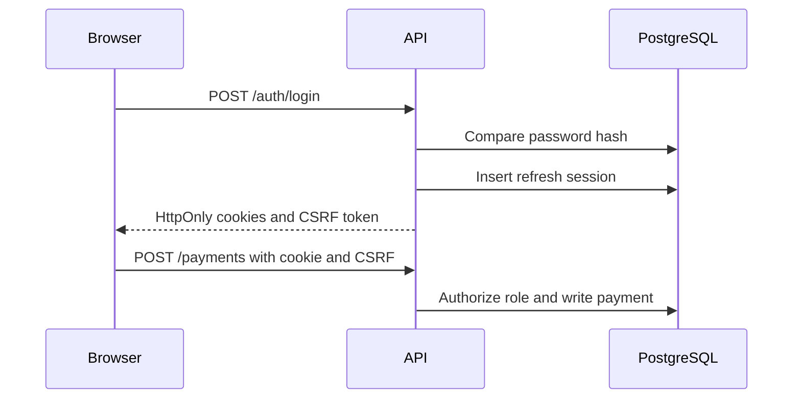

### Payment creation

1. An administrator sends `Idempotency-Key` and a body: merchant reference, `amountMinor`, currency, and scenario.
2. The service claims an idempotency row unique on `(scope, userId, key)`.
3. The simulated gateway returns approved, declined, unavailable, ambiguous, or accepted-for-later-webhook.
4. The payment, the first ledger row, the state transition, and any provider event plus outbox row commit together.
5. A timeout becomes `REQUIRES_RECONCILIATION`, not `FAILED`. A gateway failure leaves the payment `PENDING` and the idempotency row retryable, and the HTTP status is `503`.

### Idempotent retries

1. The same user, key, and payload read the stored response and return it with `Idempotent-Replayed: true`.
2. The same key with a different payload returns `409 IDEMPOTENCY_PAYLOAD_MISMATCH` and does not create a second payment.
3. Two requests in flight share one row because the unique index rejects the second insert. The loser waits for the winner or receives the stored response.
4. Keys expire after 24 hours. An expired key is not silently reused.

### Payment status transitions

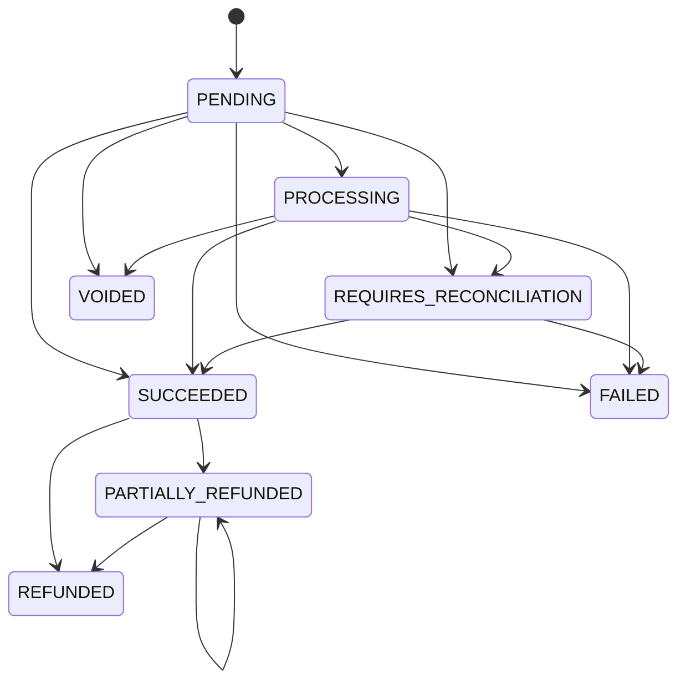

Any other move returns `409 INVALID_PAYMENT_TRANSITION`.

### Webhook event generation and delivery

1. A terminal or delayed sandbox outcome writes a `webhook_events` row and an `outbox_messages` row in the same transaction.
2. The worker publishes unpublished outbox rows to BullMQ, then processes the job.
3. Processing is idempotent. A duplicate provider event id does not apply the transition twice.
4. Merchant endpoints that subscribe to the event get a `merchant_deliveries` row. The worker POSTs the JSON body with `X-Payguard-Signature` and a 5 second timeout.

### Retry and failure handling

Provider and merchant deliveries use the same policy: up to 5 attempts, exponential backoff starting at 1 second, capped at 5 minutes, with jitter. Each attempt stores a response code or a short error summary. After the last failure the row is `DEAD_LETTER`. An administrator can replay it. Stuck `PROCESSING` rows are returned to the retry path on the next worker loop.

If the API commits the outbox row and dies before Redis accepts the job, the row stays unpublished. The worker publishes it later. Queued work is not only held in process memory.

### Reconciliation

1. An administrator runs reconciliation.
2. The matcher pairs internal payments with `provider_statements` by provider or merchant reference.
3. The run stores matched and mismatch counts. Each mismatch is an item with the internal value, the provider value, and a type.
4. Resolve or ignore records a note and an actor. It does not edit the payment. Running again creates another run rather than deleting history.

### Dashboard data flow

The console asks `GET /api/v1/dashboard/summary` for a date range. The API reads aggregates from PostgreSQL, caches the JSON in Redis for 30 seconds, and keys the cache with a version. Payment writes increment that version, so the next read misses. A cache miss, or Redis being down, falls through to PostgreSQL. Amounts are never added across currencies.

## Database design

Main entities:

- `users` and `refresh_sessions`. Email is unique. Refresh tokens are stored as SHA-256 hashes.
- `payments`, `payment_state_transitions`, and `transactions`. Merchant reference, provider reference, and transaction reference are unique.
- `idempotency_records`. Unique on `(scope, user_id, key)`. Stores the request hash, status, response, and expiry.
- `webhook_events`, `webhook_deliveries`, and `outbox_messages`. Provider event id is unique. One outbox row per event.
- `merchant_endpoints`, `merchant_deliveries`, `merchant_delivery_attempts`, and `merchant_sink_receipts`.
- `reconciliation_runs`, `reconciliation_items`, and `provider_statements`.
- `audit_logs` and `worker_heartbeats`.

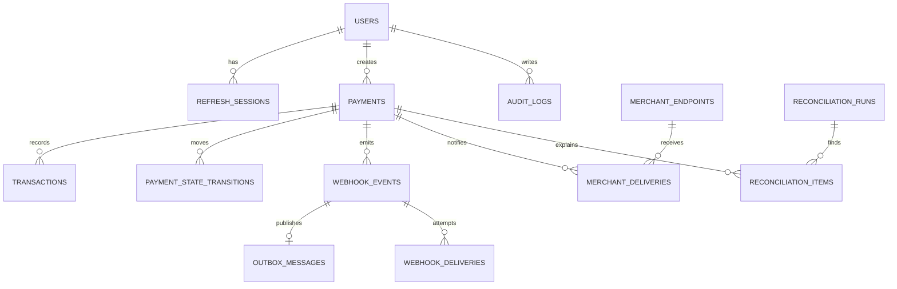

Indexes follow the list and worker queries: payment status plus created time, transaction status plus created time, webhook status plus next attempt, merchant delivery status plus next attempt, audit actor and resource, and reconciliation run plus item status. Foreign keys use cascade or set-null according to the aggregate. Money is an integer minor amount plus an ISO currency. The schema and the reasoning are also in [docs/database-design.md](docs/database-design.md).

## API reference

Interactive docs: [http://localhost:4000/api/docs](http://localhost:4000/api/docs). The document is [http://localhost:4000/api/v1/openapi.json](http://localhost:4000/api/v1/openapi.json).

Successful responses use `{ "data", "meta": { "requestId" } }`. Lists add `page`, `pageSize`, `total`, and `pageCount`. Errors use `{ "error": { "code", "message", "details", "requestId" } }` and do not include stack traces.

| Method | Path | Auth | Purpose |
| --- | --- | --- | --- |
| POST | `/api/v1/auth/register` | Public, rate limited | Create an analyst and start a session |
| POST | `/api/v1/auth/login` | Public, rate limited | Start a session |
| POST | `/api/v1/auth/refresh` | Refresh cookie, CSRF | Rotate the session |
| POST | `/api/v1/auth/logout` | Cookie, CSRF | Revoke the session |
| GET | `/api/v1/auth/me` | Access cookie | Current user and permissions |
| GET | `/api/v1/auth/csrf` | Public | Issue a CSRF token |
| POST | `/api/v1/payments` | Admin, idempotency key | Create a simulated payment |
| GET | `/api/v1/payments` | Signed in | Filter, sort, and page payments |
| GET | `/api/v1/payments/:id` | Signed in | Payment, transitions, transactions, webhooks |
| POST | `/api/v1/payments/:id/simulate` | Admin | Apply an allowed sandbox outcome |
| POST | `/api/v1/payments/:id/refunds` | Admin, idempotency key | Refund part or all of a capture |
| POST | `/api/v1/payments/:id/void` | Admin, idempotency key | Void before capture |
| GET | `/api/v1/transactions` | Signed in | Ledger list |
| GET | `/api/v1/webhooks` | Signed in | Provider events and deliveries |
| POST | `/api/v1/webhooks/sandbox/events` | HMAC | Accept a simulated provider event |
| POST | `/api/v1/webhooks/:id/replay` | Admin | Replay a failed or dead-letter event |
| GET, POST | `/api/v1/merchant-webhooks` | Read, or admin to create | Endpoints. The secret is returned once |
| GET | `/api/v1/merchant-webhooks/deliveries` | Signed in | Delivery history |
| POST | `/api/v1/merchant-webhooks/deliveries/:id/replay` | Admin | Replay a failed delivery |
| POST | `/api/v1/merchant-webhooks/sink` | HMAC | Local development sink |
| GET | `/api/v1/exceptions` | Signed in | Unknown outcomes and open failures |
| POST | `/api/v1/exceptions/payments/:id/decide` | Admin | Decide an unknown outcome |
| POST | `/api/v1/reconciliation/runs` | Admin | Compare payments with the statement |
| GET | `/api/v1/reconciliation/runs/:id` | Signed in | Run and mismatch items |
| POST | `/api/v1/reconciliation/items/:id/resolve` | Admin | Resolve or ignore an item |
| GET | `/api/v1/audit-logs` | Admin | Audit history |
| GET | `/api/v1/dashboard/summary` | Signed in | Operational totals |
| GET | `/health/live` | Public | Process is up |
| GET | `/health/ready` | Public | PostgreSQL and Redis answer |
| GET | `/api/v1/health` | Signed in | Dependencies, worker heartbeat, queue depth |

Field rules and examples are in the OpenAPI document and in [docs/api-documentation.md](docs/api-documentation.md).

## Installation and local setup

Prerequisites: Node.js 22 or newer, npm, and either Docker or a local PostgreSQL 16 and Redis 7.

From the repository root:

```bash
cp .env.example .env
cp backend/.env.example backend/.env
cp frontend/.env.example frontend/.env
npm install
npm run install:all
```

Start PostgreSQL and Redis:

```bash
npm run docker:infra
```

That command runs `docker compose up -d postgres redis` from the root. If PostgreSQL is already listening on `127.0.0.1:5432`, use that instance and do not start a second one on the same port. Create the databases once:

```bash
docker compose exec postgres psql -U payguard -d postgres -c "CREATE DATABASE payguard_test OWNER payguard;"
```

Skip that statement if the role and database already exist. Apply migrations and seed from the root. The seed refuses to replace an existing dataset unless `SEED_REPLACE=true`.

```bash
npm run db:migrate
npm run db:seed
```

Start the API, the worker, and the frontend in one terminal. `Ctrl-C` stops all three.

```bash
npm run dev
```

Or start them separately, each in its own terminal, from the root:

```bash
npm run dev:api
npm run dev:worker
npm run dev:web
```

Open [http://localhost:5173](http://localhost:5173). Use `localhost` for the site and the API so the session cookie is sent. API docs: [http://localhost:4000/api/docs](http://localhost:4000/api/docs).

Tests, from the root:

```bash
npm test
npm run test:unit
npm run test:integration
```

Production build, from the root:

```bash
npm run build
```

The API build is `tsc` in `backend/`. The frontend build typechecks and writes `frontend/dist`. Compose can also build the full stack with `npm run docker:full`. That path applies migrations when the API container starts. It does not seed. Seed with:

```bash
docker compose run --rm backend npm run db:seed
```

### Demo logins

These passwords are for the local seed only. The seed refuses them when `NODE_ENV=production` unless `ALLOW_DEMO_SEED=true`.

| Role | Email | Password |
| --- | --- | --- |
| Admin | admin@payguard.local | PayGuard-Admin-Demo-1 |
| Analyst | analyst@payguard.local | PayGuard-Analyst-Demo-1 |

The seeded administrator is Amina Shah. The seeded analyst is Leo Martins. A self-registered account is an analyst.

### Troubleshooting

- **Cookie is not sent.** Open the console on `localhost`, not a mix of `localhost` and `127.0.0.1`.
- **Port 5432 is already in use.** A local PostgreSQL is enough. Point `DATABASE_URL` and `DIRECT_URL` at it, and create `payguard` and `payguard_test` there. Do not run a second Postgres on the same port.
- **`Demo data already exists`.** The seed found rows and stopped. Use the existing data, or set `SEED_REPLACE=true` for one run if you intend to delete the sandbox rows.
- **Integration tests refuse to start.** `DATABASE_URL` must contain `payguard_test`. The Vitest config sets this. Create that database before `npm run test:integration`.
- **Login returns 503.** Redis is down, and the rate limit fails closed. Start Redis.
- **Worker looks idle.** Start `npm run dev:worker`. Health shows the heartbeat only after the worker has written one.

## Environment variables

Placeholders live in `backend/.env.example` and `frontend/.env.example`. Do not commit a filled `.env`. The names and why they exist:

| Variable | Purpose |
| --- | --- |
| `NODE_ENV` | `development`, `test`, or `production`. Production rejects the example secrets. |
| `PORT`, `HOST` | API bind address. Default port 4000. |
| `DATABASE_URL` | Pooled or local Prisma connection. |
| `DIRECT_URL` | Migration connection. Locally it can match `DATABASE_URL`. |
| `REDIS_URL` | Cache, rate limits, denylist, and BullMQ. |
| `JWT_ACCESS_SECRET`, `JWT_REFRESH_SECRET` | Signing secrets. Use different values. Never log them. |
| `ACCESS_TOKEN_TTL_SECONDS`, `REFRESH_TOKEN_TTL_SECONDS` | Cookie lifetimes. Defaults are 15 minutes and 7 days. |
| `CORS_ORIGINS` | Exact allowed browser origins. |
| `COOKIE_SECURE`, `COOKIE_SAMESITE` | Cookie flags. `SameSite=None` requires `Secure`. Local HTTP uses `false` and `lax`. |
| `WEBHOOK_SANDBOX_SECRET` | HMAC key for simulated provider events. |
| `LOG_LEVEL` | Pino level. |
| `BCRYPT_ROUNDS` | Password hashing cost. |
| `TRUST_PROXY` | Honor `X-Forwarded-*` only behind a trusted proxy. |
| `LOGIN_RATE_LIMIT_MAX`, `LOGIN_RATE_LIMIT_WINDOW_SECONDS` | Login and registration limits. |
| `PAYMENT_RATE_LIMIT_MAX`, `PAYMENT_RATE_LIMIT_WINDOW_SECONDS` | Payment creation limit. |
| `WORKER_CONCURRENCY` | BullMQ jobs processed at once. Default 4. |
| `VITE_API_URL` | Frontend API base, including `/api/v1`. Baked in at build time. |

`ALLOW_DEMO_SEED` and `SEED_REPLACE` are one-shot seed flags, not service configuration. The full notes are in [docs/environment.md](docs/environment.md).

## Demo walkthrough

About five minutes, with `npm run dev` running and the seed loaded.

1. Open [http://localhost:5173/login](http://localhost:5173/login). Choose **Use admin demo**, then **Sign in**. The overview shows volume by currency, success and failure counts, and recent payments. Unknown outcomes are separate from failures.
2. Open **Payments** and create a sandbox payment. Use merchant reference `order_live_demo_1`, amount `25.99`, currency `USD`, and scenario `success`. The detail page shows `SUCCEEDED` and a capture transaction.
3. Repeat the create with the same idempotency key. From a terminal:

```bash
curl -c /tmp/payguard.txt -H 'content-type: application/json' \
  -d '{"email":"admin@payguard.local","password":"PayGuard-Admin-Demo-1"}' \
  http://localhost:4000/api/v1/auth/login

curl -b /tmp/payguard.txt -c /tmp/payguard.txt -H 'content-type: application/json' \
  -H 'x-csrf-token: THE_CSRF_TOKEN' \
  -H 'idempotency-key: demo-key-1001' \
  -d '{"merchantReference":"order_demo_1001","amountMinor":2599,"currency":"USD","scenario":"success"}' \
  http://localhost:4000/api/v1/payments
```

The CSRF token is the `payguard_csrf` cookie from the login response. Run the second command again. The same payment id comes back with `Idempotent-Replayed: true`. Change `amountMinor` and the same key returns `409`.

4. Open **Webhooks**. Seeded events include processed deliveries and a dead-letter event, `evt_seed_dead_letter`. An administrator can replay a failed or dead-letter event. A processed event is rejected.
5. Open **Reconciliation** and the seeded run. It reports 26 matched payments and 5 unresolved mismatches, including amount, missing records, status, and a duplicate provider event. **Review** records a decision and does not change the payment.
6. Open **Audit log**. Filter by `payment.created` or `auth.login`. The row shows the actor, action, resource, and request id. It does not show the password or a webhook secret.

Sign out, then register an analyst at `/register`. That account can open the dashboard and cannot create a payment or open the audit log.

## Engineering decisions

- **Modular monolith.** One codebase and two processes are enough to show a queue, an outbox, and a hard database boundary. Separate deployable services would add network failure modes this sandbox does not need.
- **Transactions.** Status, ledger row, audit row, and outbox row that belong to one outcome commit together. The simulated gateway call stays outside the transaction so a slow provider does not hold a database lock.
- **Idempotency.** Duplicate protection is a unique key in PostgreSQL, not a Redis lock. Redis can lose a lock. The unique index cannot insert a second row.
- **Cache.** Dashboard reads are cached for 30 seconds and invalidated with a version counter. Payment reads do not use that cache.
- **Queue.** BullMQ is at-least-once. The consumer checks the provider event id and the current payment state before applying a transition. The outbox covers the gap between the database commit and the queue.
- **Retries.** Five attempts and a capped exponential delay keep a dead endpoint from spinning forever. Dead-letter rows stay visible for replay.
- **Audit and logs.** Request ids are on every response. Pino logs the method and path, not the body. Audit metadata omits passwords, tokens, and signing secrets.

## Testing and known limitations

From the root:

```bash
npm test
npm run test:unit
npm run test:integration
npm run typecheck
npm run lint
```

Backend unit tests cover the state machine, money checks, idempotency hashing, retry delay, reconciliation mismatches, role checks, and environment rules. Integration tests use `payguard_test` and Redis. They cover registration, login, authorization, idempotent and concurrent payment creation, invalid transitions, webhook deduplication and retry, and reconciliation persistence. They truncate sandbox tables between tests and refuse to run if the URL does not contain `payguard_test`.

Frontend tests cover login and registration validation, anonymous route protection, the refresh-retry rule, and the payment table loading, empty, error, and populated states.

Known limitations:

- The gateway is deterministic and in-process.
- Only two-decimal currencies are supported.
- Registration cannot create an administrator.
- Dashboard cache staleness is bounded by 30 seconds. It is not used for payment status.
- The access-token denylist is best-effort. Logout is authoritative because the refresh session is revoked in PostgreSQL.
- Rate-limited routes return `503 RATE_LIMIT_UNAVAILABLE` when Redis cannot count.
- Merchant URL policy blocks obvious private addresses. It does not resolve DNS and then re-check the address.
- A full Docker application stack sleeps with its host. That is a local demo, not a production payment processor.

A baseline review is in [docs/PROJECT_AUDIT.md](docs/PROJECT_AUDIT.md). Hosting notes, which this repository does not apply by itself, are in [docs/deployment.md](docs/deployment.md).

## Future roadmap

- A created-at control on the payments screen. The API already accepts `from` and `to`.
- Stronger merchant URL checks after DNS resolution, still without calling arbitrary internal networks.
- A retention job for expired idempotency rows and old webhook attempts.
- OpenTelemetry traces across the API and the worker.
- Contract tests that diff the running routes against the OpenAPI document.

These are not implemented.

## Interview discussion points

- **Backend shape.** A modular monolith with an explicit worker shows where a queue belongs without pretending the system is distributed.
- **Reliability.** Idempotency keys, unique constraints, and an outbox answer duplicate requests and crashed processes. Retries are bounded and visible.
- **Data.** Minor units, status constraints, and indexes match the queries the console and the worker actually run. Reconciliation history is append-only.
- **API design.** One error envelope, Zod at the edge, pagination, and OpenAPI that lists the routes the server mounts.
- **Security.** Bcrypt, HttpOnly cookies, CSRF, role checks on every mutating route, rate limits that fail closed, and HMAC on webhooks. Secrets are not returned from list endpoints or written to the audit log.
- **Async work.** At-least-once delivery is safe because consumers check event ids and payment state before they write.
- **System design.** PostgreSQL owns correctness. Redis owns speed and scheduling. The dashboard cache cannot overrule a payment row.

## License and contribution

This repository does not include a license file. Do not assume a particular open-source license. Third-party packages remain under their own licenses, listed in the lockfiles.

The project is a portfolio demonstration. It does not publish a contribution policy, and it does not claim ownership of PostgreSQL, Redis, React, or the other dependencies.
