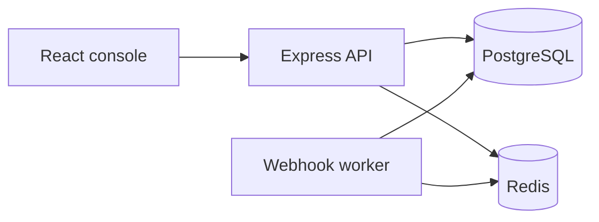

# PayGuard

PayGuard is a sandbox payment-operations console. It records simulated charges, keeps payment state consistent under retries, and shows webhook and reconciliation failures to an operator. It does not move money and it never asks for a real card number, CVV, or bank credential.

The problem it demonstrates: a payment request, a provider call, and a webhook can all be duplicated or interrupted. The ledger still has to show one payment, a clear state, and an audit trail.

## Features

- Email and password login with short-lived access cookies, rotating refresh sessions, CSRF checks, and admin/analyst roles.
- Simulated payments with an explicit state machine: pending, processing, succeeded, failed, and unknown outcome.
- Idempotent payment creation backed by a PostgreSQL unique key.
- Webhook inbox, outbox, BullMQ worker, bounded retries, and dead-letter replay.
- Reconciliation against a sandbox provider statement, with audited resolve/ignore actions.
- Dashboard, payments, transactions, webhooks, audit log, and health pages on live API data.
- OpenAPI docs, Docker Compose, migrations, seed data, and automated tests.

## Architecture



PostgreSQL owns payment state. Redis caches dashboard summaries, counts rate limits, and hosts the queue. The worker is at-least-once; consumers are idempotent. Details are in [docs/architecture.md](docs/architecture.md), [docs/database-design.md](docs/database-design.md), [docs/api-documentation.md](docs/api-documentation.md), and [docs/reliability.md](docs/reliability.md).

## Repository

```text
backend/src/modules   identity, payments, transactions, idempotency, webhooks,
                      reconciliation, audit, dashboard, health, jobs
backend/prisma        schema, migration, seed
frontend/src          React console
docs                  design notes
scripts/perf-smoke.mjs
docker-compose.yml
```

## Local setup

Requirements: Node.js 22+, PostgreSQL 16+, Redis 7+.

```bash
cp backend/.env.example backend/.env
cp frontend/.env.example frontend/.env
npm install
npm install --prefix backend
npm install --prefix frontend
npm run db:migrate
npm run db:seed
# After the first seed, replacing the dataset requires:
# SEED_REPLACE=true npm run db:seed
npm run dev
```

Open [http://localhost:5173](http://localhost:5173). The API listens on port 4000. Use `localhost` for both, not a mix of `localhost` and `127.0.0.1`, so the session cookie is sent. API docs: [http://localhost:4000/api/docs](http://localhost:4000/api/docs).

Docker Compose also defines PostgreSQL, Redis, the API, the worker, and the frontend:

```bash
cp .env.example .env
cp backend/.env.example backend/.env
docker compose up --build
```

Compose applies migrations when the API container starts. It does not seed data. Seed once into an empty database:

```bash
docker compose run --rm backend npm run db:seed
```

To replace an existing sandbox dataset, add `SEED_REPLACE=true`. The web UI is published on port 8080.

Public hosting on Render, Neon, and Upstash is described in [docs/deployment.md](docs/deployment.md). Environment names are listed in [docs/environment.md](docs/environment.md).

## Demo logins

Local seed only. These passwords are refused when `NODE_ENV=production` unless `ALLOW_DEMO_SEED=true`.

| Role | Email | Password |
| --- | --- | --- |
| Admin | admin@payguard.local | PayGuard-Admin-Demo-1 |
| Analyst | analyst@payguard.local | PayGuard-Analyst-Demo-1 |

Analysts can view operations. They cannot create payments, simulate outcomes, replay webhooks, run reconciliation, resolve mismatches, or read the audit log.

## Tests

```bash
npm test
npm run test:unit
npm run test:integration
```

Integration tests use the `payguard_test` database and Redis. They refuse to run if the URL does not contain `payguard_test`. Create it once:

```sql
CREATE DATABASE payguard_test OWNER payguard;
```

Backend unit tests cover the state machine, money validation, idempotency hashing, retry delay, reconciliation mismatches, and role checks. Integration tests cover login, authorization, idempotent and concurrent payment creation, invalid transitions, webhook deduplication, retry, reconciliation persistence, and the positive-amount check.

Frontend tests cover login validation, anonymous route protection, refresh-retry rules, and the payment table loading, empty, error, and populated states.

### Manual session check

1. Sign in and confirm `payguard_access` is HttpOnly and is not in `localStorage`.
2. Call a protected API after the access cookie expires and confirm one refresh, then the original request.
3. Revoke the session from a second tab and confirm the next refresh logs you out instead of issuing a new session.

## Example calls

```bash
curl -c /tmp/payguard.txt -H 'content-type: application/json' \
  -d '{"email":"admin@payguard.local","password":"PayGuard-Admin-Demo-1"}' \
  http://localhost:4000/api/v1/auth/login

curl -b /tmp/payguard.txt -H 'content-type: application/json' \
  -H 'x-csrf-token: THE_CSRF_TOKEN' \
  -H 'idempotency-key: demo-key-1001' \
  -d '{"merchantReference":"order_demo_1","amountMinor":2599,"currency":"USD","scenario":"success"}' \
  http://localhost:4000/api/v1/payments
```

Repeat the second command. The same payment id is returned with `Idempotent-Replayed: true`.

## Performance smoke

`node scripts/perf-smoke.mjs` logs in and times health and payment-list calls from this machine. It is a single-client local smoke check, not a capacity test.

Measured on 24 Oct 2026 against the local API (`localhost:4000`, seeded PostgreSQL, Redis up):

| Request | Samples | p50 | p95 | max |
| --- | ---: | ---: | ---: | ---: |
| `GET /health/live` | 50 | 0.3 ms | 1.3 ms | 2.6 ms |
| `GET /api/v1/payments?pageSize=20` | 30 | 1.4 ms | 2.8 ms | 8.6 ms |

These numbers are loopback timings from one Node process. They are not a production throughput result.

## Screenshots

Capture these after `npm run dev` while signed in as the admin:

- Login at `/login`
- Overview at `/`
- Payments at `/payments`
- A payment detail page, including state history
- Reconciliation run detail
- System health

A local browser pass confirmed the seeded overview (42 payments, mixed statuses), the payments table, an unknown-outcome payment with simulate actions, a reconciliation run of 26 matched and 5 unresolved mismatches, and health showing PostgreSQL, Redis, and the worker up.

## Limitations

- The gateway is deterministic and in-process. There is no card network.
- Only two-decimal currencies are supported.
- There is no self-service registration.
- Dashboard figures can be up to 30 seconds stale. Payment status is always read from PostgreSQL.
- The access-token denylist depends on Redis. Refresh revocation in PostgreSQL is the real logout boundary.
- Rate limits fail closed while Redis is unavailable.
- A free Render web service sleeps after idle time, and the webhook worker sleeps with it. That is not a production payment processor. See [docs/deployment.md](docs/deployment.md).
