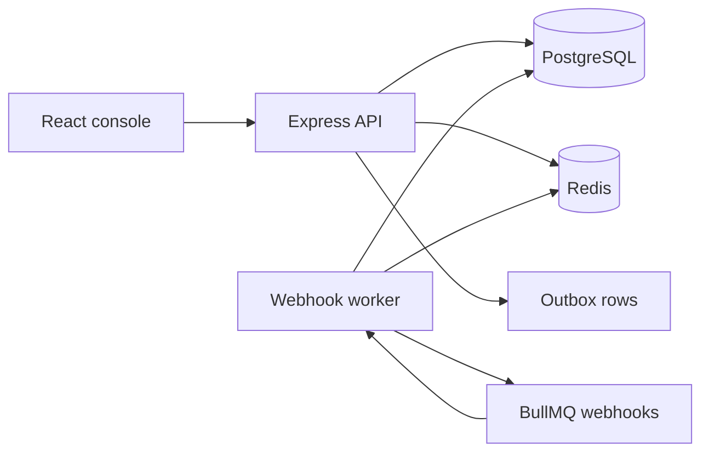

# Architecture

PayGuard is a modular monolith. The API and the webhook worker are separate processes that share one PostgreSQL database and one Redis instance. They are not independently deployed services.

## Request path

`Route → authentication and authorization → Zod validation → controller → service → repository → PostgreSQL`

Controllers only map HTTP. Services own transactions, the payment state machine, idempotency, and audit writes. Repositories hide Prisma queries.

## Why these stores

PostgreSQL is the source of truth for users, payments, transactions, idempotency keys, webhook events, reconciliation, and audit logs. Unique constraints and conditional updates make duplicate protection correct even if two API processes run.

Redis holds short-lived dashboard cache entries, login and payment rate-limit counters, the access-token denylist, and the BullMQ queue. Losing Redis must not invent a payment status. The API keeps serving reads from PostgreSQL when the cache is down. Login and other rate-limited routes fail closed with `503 RATE_LIMIT_UNAVAILABLE` instead of skipping the limit.

BullMQ gives at-least-once delivery. Webhook handlers are idempotent and the provider event id is unique, so a repeated job does not apply the same transition twice.

## Process model

- `backend/src/index.ts` serves HTTP, including `/health/live` and `/health/ready`.
- `backend/src/worker.ts` publishes unpublished outbox rows, processes webhook jobs, delivers merchant webhooks, recovers events stuck in `PROCESSING`, and writes a worker heartbeat.
- The React app talks to the API with cookies. It does not connect to PostgreSQL or Redis.

## Failure boundaries

The gateway call happens outside a database transaction. Local writes that must succeed together — payment status, ledger row, webhook event, and outbox row — commit in one transaction. If the process dies after that commit and before Redis accepts the job, the outbox row stays unpublished and the worker publishes it later.
