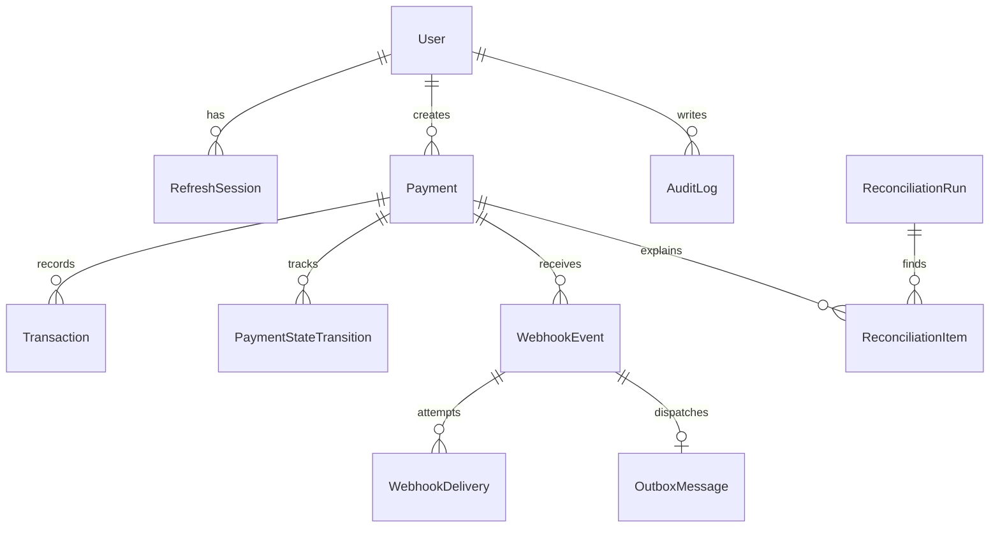

# Database design

PostgreSQL stores every authoritative record. Money is an integer minor-unit amount (`amount_minor`) plus an ISO currency code. Supported currencies in this sandbox are USD, INR, EUR, and GBP, all of which use two decimal places.

## Constraints that protect correctness

- `users.email` is unique.
- `refresh_sessions.token_hash` is unique. Logout and refresh rotation set `revoked_at`.
- `payments.merchant_reference` and `payments.provider_reference` are unique. `idempotency_key` is unique when present.
- `payments.amount_minor > 0` and the currency matches `^[A-Z]{3}$`. The same checks exist on transactions and provider statements.
- `idempotency_records (scope, user_id, key)` is unique. A version column lets one caller reclaim a failed or stale in-progress row.
- `webhook_events.provider_event_id` is unique.
- `webhook_deliveries (webhook_event_id, attempt_number)` is unique.
- A partial index `outbox_unpublished_idx` finds rows whose `published_at` is null.

## Indexes that match queries

- Payments are listed and aggregated by `status, created_at` and sorted by `created_at`.
- Transactions are loaded by `payment_id`.
- Webhook recovery scans `status, next_attempt_at`.
- Audit screens filter by `created_at`, actor, and resource.
- Reconciliation items are read by run and status.

## Idempotency records

A row starts as `IN_PROGRESS`. A completed row stores the response code and JSON body for 24 hours. Repeating the same key and payload returns that body. A different payload returns `409 IDEMPOTENCY_PAYLOAD_MISMATCH`. An expired completed key is not recycled. A failed attempt can be retried with the same key and resumes the payment already stored in `resource_id`.

## Provider statement

`provider_statements` is the deterministic sandbox statement used by reconciliation. It is not a second copy of payment status. Mismatches are stored on `reconciliation_items` and are not auto-resolved.
