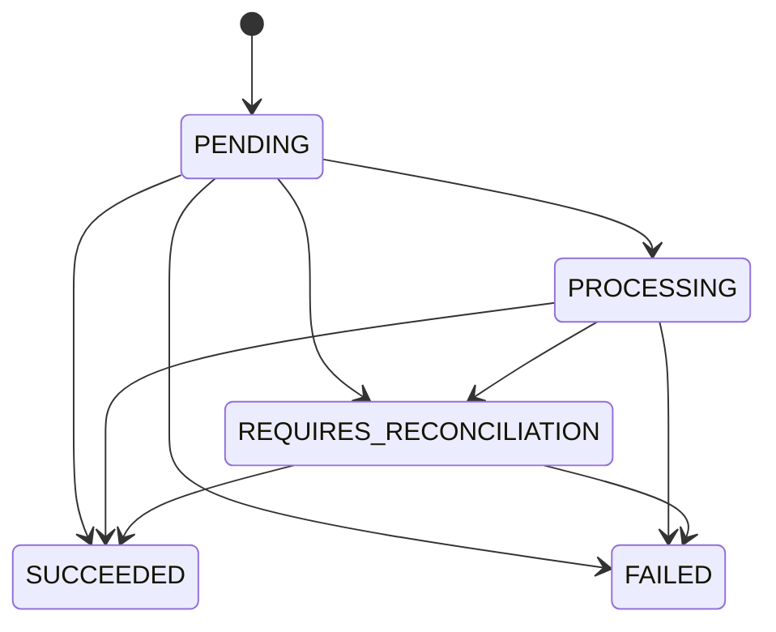

# Reliability

## Payment state

`SUCCEEDED` and `FAILED` are terminal. `REQUIRES_RECONCILIATION` means the gateway timed out or the outcome is otherwise unknown. PayGuard does not mark that payment failed.

Status changes use `UPDATE ... WHERE status = current`. If another worker already moved the row, the update affects zero rows and the request returns `409 PAYMENT_CONFLICT` or the webhook retries.

## Duplicated payment request

The idempotency key is unique per user and scope in PostgreSQL. Concurrent requests with the same key and payload share one payment. A different payload conflicts. The original completed response is stored and replayed with `Idempotent-Replayed: true`. An in-progress key is polled briefly and then returns `409 IDEMPOTENCY_IN_PROGRESS`. A stale in-progress row can be reclaimed with a conditional version update.

## Webhook delivered twice

The provider event id is unique. The second insert is acknowledged as a duplicate. If two jobs still run, the handler claims the event with a conditional status update and, once the payment is already in the target state, records the delivery without a second ledger entry.

## Worker crash

A crash after the event is marked `PROCESSING` leaves it there. The worker resets events that have been processing for more than 60 seconds, clears the outbox published timestamp, and publishes them again. Attempts, errors, and delivery rows are stored. After five consecutive failures the event becomes `DEAD_LETTER`. An administrator can replay it.

## Redis unavailable

Dashboard reads fall through to PostgreSQL. Payment status is never taken from the cache. Rate limits fail closed. New webhook jobs wait in the outbox until Redis accepts them. Access-token denylist checks are best-effort because the access token is short-lived; refresh revocation in PostgreSQL is the session boundary. Logout still revokes the refresh session when Redis is down.

## Ambiguous provider result

`timeout` stores `REQUIRES_RECONCILIATION`, a pending ledger row, and a failure code of `GATEWAY_TIMEOUT`. Reconciliation can show a status or amount mismatch. An administrator must explicitly simulate success or decline. Resolution of a reconciliation item only records the decision.

## Retry schedule

Webhook retries wait `min(5 minutes, 1s * 2^(attempt-1))` plus up to 20 percent jitter. The schedule is covered by unit tests. Queue delivery is at-least-once; the database claim is what prevents double application.

## Cache

Dashboard summaries use `dashboard:summary:{version}:{from}:{to}:{currency}` with a 30 second TTL. Payment mutations increment `cache:version:dashboard`. A stale summary cannot overwrite a payment row.
